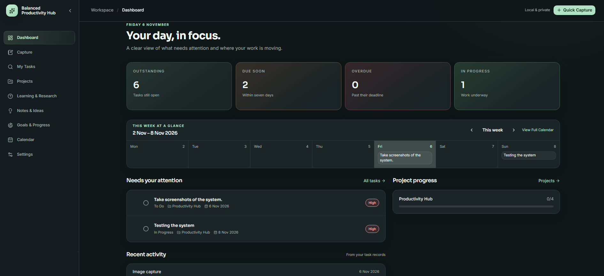
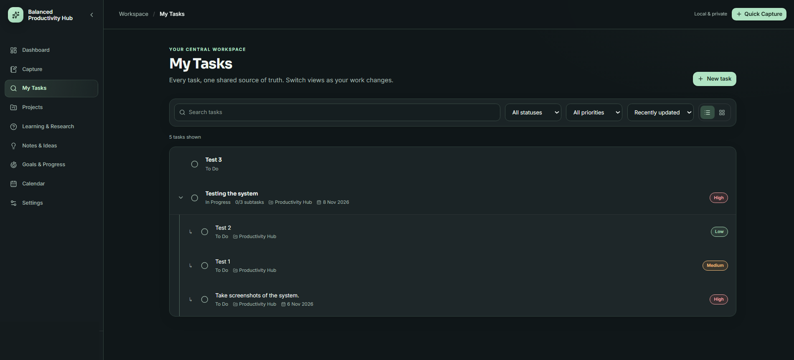
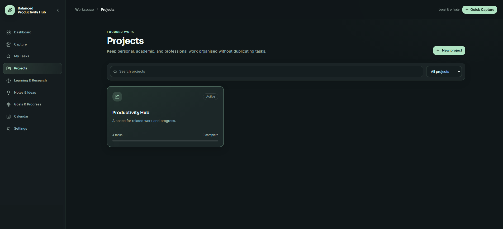
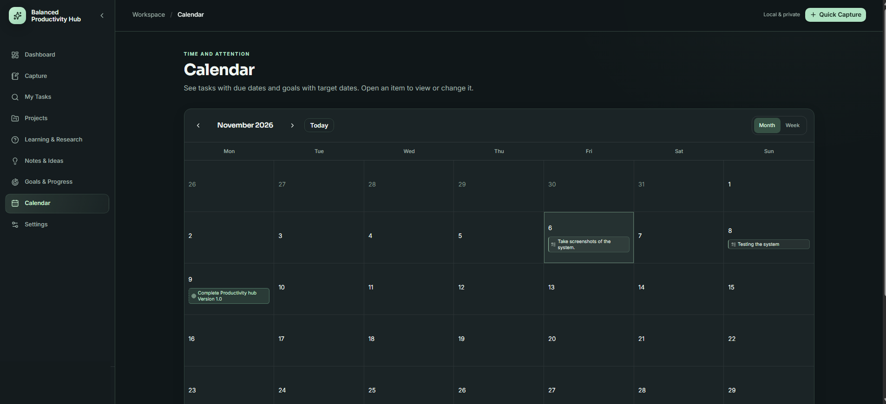
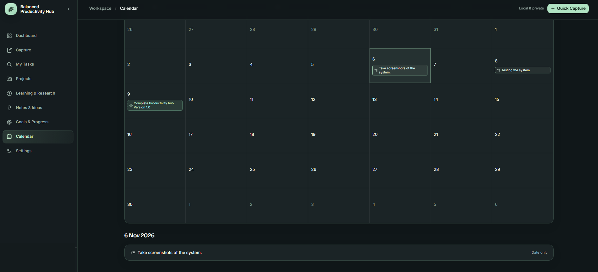
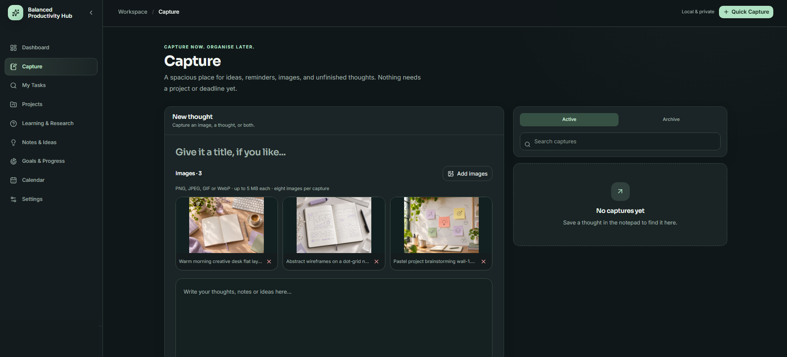

# Balanced Productivity Hub

**A full-stack productivity management application built with React, TypeScript, ASP.NET Core and SQL Server.**

Balanced Productivity Hub is a personal productivity application designed to bring tasks, projects, goals, research, notes and everyday ideas into one organised workspace.

The application features a modern dark-themed interface, secure user authentication and persistent data storage.

> **Portfolio showcase:** This repository documents the completed application and its technical implementation. The source code is not publicly distributed.

## Application Preview

## Key Features

### Dashboard
- Overview of outstanding, upcoming and overdue tasks
- Weekly calendar with scheduled activities
- Project progress tracking
- Recent task activity

### Task Management
- Create, edit, complete and delete tasks
- Parent tasks and nested subtasks
- Priority levels and task statuses
- Optional deadlines and due times
- Search, filtering and sorting

### Project Management
- Organise related tasks into projects
- Track project progress
- Manage linked tasks and subtasks

### Capture Workspace
- Quickly record ideas, reminders and unfinished thoughts
- Save text, images or a combination of both
- Multiple image attachments
- Edit, organise and archive captures

### Calendar
- Monthly and weekly calendar views
- Visualise tasks and goals by date
- Open and manage scheduled items

### Additional Features
- Notes and Ideas
- Learning and Research tracking
- Goals and Progress
- Global Quick Capture
- Responsive interface
- User-specific data persistence

## Technology Stack

| Layer | Technologies |
|---|---|
| Frontend | React, TypeScript, Vite |
| Styling | Tailwind CSS, shadcn/ui, Lucide Icons |
| Backend | ASP.NET Core 10, C# |
| Database | Microsoft SQL Server |
| Data Access | Entity Framework Core |
| Authentication | ASP.NET Core Identity, secure cookie authentication |
| Development Tools | Visual Studio, VS Code, Git, GitHub |

## Technical Highlights

**Full-stack architecture:** Developed a React frontend connected to an ASP.NET Core backend through REST API endpoints.

**Database integration:** Used Entity Framework Core and SQL Server to manage persistent application data and relationships.

**Authentication and security:** Implemented account-based authentication, protected API access and user-specific data handling.

**Task hierarchy:** Supported parent-child task relationships, completion tracking and project associations.

**Image management:** Implemented image attachments within the Capture workspace, including upload, preview, editing and persistence.

**User interface:** Designed a responsive dark-themed interface using reusable components, Sora and Inter typography, and subtle glass-and-gradient styling.

## Screenshots

### Task Management

### Projects

### Calendar

### Calendar Details

### Capture Workspace

## Project Status

**Version 1.0 — Completed**

The application has been developed and tested as a local full-stack productivity solution.

This repository is intended to showcase the project for professional and portfolio purposes.

The application source code, database configuration and commercial distribution files are not included in this public repository.

## Developer

**Kailin Pillay**

Diploma in ICT (Applications Development) — Durban University of Technology

Interested in software development, full-stack applications and building practical solutions to everyday problems.

[LinkedIn](https://www.linkedin.com/in/kailin-pillay-77002522b) | [GitHub](https://github.com/BiggieBigs15)

---

*Balanced Productivity Hub — Full-Stack Development Portfolio Project*
